<div align="center">

<picture>
  <source media="(prefers-color-scheme: dark)" srcset="./assets/banner-dark.svg">
  <source media="(prefers-color-scheme: light)" srcset="./assets/banner-light.svg">
  
</picture>

</div>

<br/>

<table align="center" border="0">
<tr>
<td width="38%" align="center" valign="middle">



</td>
<td width="62%" valign="middle">

### 🚀 Projetos em destaque

| Projeto | 💻 Tech | Status |
|:---|:---:|:---:|
| 🏥 SmartClin | `Next.js` `TypeScript` `Stripe` | 🔒 Privado |
| 🌐 [Portfólio profissional](https://zayroncode.com.br/portfolio/robson-soares) | `React` `TypeScript` | 🟢 Online |
| ⛪ Ministério Plantar | `Java` `Spring Boot` `PostgreSQL` | 🔒 Privado |

<br/>

> 💬 *"Construindo soluções, aprendendo sempre."*

</td>
</tr>
</table>

<br/>

<details>
<summary><code>public class RobsonSoares</code></summary>

```java
public final class RobsonSoares {

    private final String role = "Full Stack Developer • Java + TypeScript/React";

    private final String[] backend = {
        "Java", "Spring Boot", "Node.js", "NestJS", "PHP", "Laravel"
    };

    private final String[] frontend = {
        "TypeScript", "React", "Next.js"
    };

    private final String[] databases = {
        "PostgreSQL", "MySQL", "SQL Server", "Oracle SQL", "MongoDB", "Firebase"
    };

    public String mission() {
        return "Construir soluções e aprender sempre.";
    }
}
```

</details>

<br/>

<br/>

<div align="center">

### 📊 Estatísticas do GitHub


<sub>Dados públicos conferidos em 04/11/2026. As contagens da stack são as tecnologias listadas acima, não linhas de código.</sub>

<br/>


<br/><br/>

### 🐍 Minhas contribuições em movimento

<sub>Gráfico atualizado a cada 12 horas pelo GitHub Actions, a partir das contribuições exibidas pelo GitHub.</sub>

<picture>
  <source media="(prefers-color-scheme: dark)" srcset="https://raw.githubusercontent.com/robsonejsoares/robsonejsoares/output/github-snake-dark.svg">
  <source media="(prefers-color-scheme: light)" srcset="https://raw.githubusercontent.com/robsonejsoares/robsonejsoares/output/github-snake.svg">
  
</picture>

<br/><br/>

### 📫 Let's Connect

<a href="https://github.com/robsonejsoares"></a>
<a href="https://www.linkedin.com/in/robson-soares-b22513170/"></a>
<a href="https://discord.com/users/1192560342568554517"></a>
<a href="https://t.me/robsonejsoares"></a>

<br/><br/>

*⭐ Always learning, always building, always connecting systems.*

</div>
