&nbsp;&nbsp;
&nbsp;&nbsp;
&nbsp;&nbsp;

 

<picture>
  <source media="(prefers-color-scheme: dark)" srcset="./assets/banner-dark.svg">
  <source media="(prefers-color-scheme: light)" srcset="./assets/banner-light.svg">
  
</picture>

 

 

 

 

<picture>
  <source media="(prefers-color-scheme: dark)" srcset="https://raw.githubusercontent.com/robsonejsoares/robsonejsoares/output/github-snake-dark.svg">
  <source media="(prefers-color-scheme: light)" srcset="https://raw.githubusercontent.com/robsonejsoares/robsonejsoares/output/github-snake.svg">
  
</picture>

